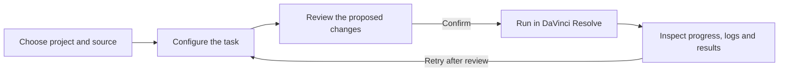

<div align="center">
  
  <h1>Clip Assassin</h1>
  <p><strong>Spend your edit on the story—not the setup.</strong></p>
  <p>A local-first workflow console for DaVinci Resolve: prep camera media, shape timelines, install titles, and run repetitive edit tasks with review and job history.</p>
  <p>
    <a href="https://github.com/zabid-coder/clip-assassin-v2/releases"></a>
    <a href="https://github.com/zabid-coder/clip-assassin-v2/blob/main/LICENSE"></a>
    
    
  </p>
  <p><a href="#get-started">Get started</a> · <a href="#what-you-can-do">Explore features</a> · <a href="#bundled-template-library">Template library</a> · <a href="#docs">Documentation</a></p>
</div>

---

## Editing time is expensive. Repetitive setup shouldn't be.

Clip Assassin is a desktop companion for editors who work in DaVinci Resolve and want the repetitive parts to feel deliberate: organize a card-based ingest, build a clean project structure, create a new timeline safely, install a title package with a clear review step, or queue a cut and inspect what happened afterward.

It runs on your machine and talks to Resolve through its scripting API. Your media stays where it is; the app helps organize and operate on the project you choose. Resolve actions are presented as reviewable tasks, with job history and logs available when they finish.

<div align="center">
  <strong>12 bundled Resolve packages</strong> &nbsp;·&nbsp;
  <strong>547 library entries</strong> &nbsp;·&nbsp;
  <strong>20 guided editing &amp; export tools</strong> &nbsp;·&nbsp;
  <strong>40 passing backend tests</strong>
</div>

## What you can do

| Workspace | Designed for | Examples |
| --- | --- | --- |
| **Master Ingest** | Repeatable project and media setup | Save visual folder presets; map camera, day and card folders; create Resolve bins and an individual timeline for each media group. |
| **Cut & Trim** | Build new timelines from selected footage | Split, trim, extract, merge, ripple-delete and create J/L cuts while preserving the source timeline. |
| **Magic Tools** | Fast editorial actions in Resolve | Organize Media Pool bins, rename clips, add titles or adjustment clips, auto-sync separate audio, and reframe for social formats. |
| **Process** | Shape timeline content | Remove silence, extract markers and apply audio-oriented processing to reviewed timeline copies. |
| **Export** | Get delivery files out consistently | Batch render selected timelines; export project data and structured outputs using reusable settings. |
| **Templates** | Install and maintain bundled title/effect packs | Preview package contents, inspect fonts and dependencies, review destinations, install, verify, repair or remove managed files. |
| **Connections** | Add optional speech and publishing providers | Generate Resolve subtitles, run local Whisper or consent-based OpenAI transcription, and configure YouTube upload. |
| **Jobs & Results** | Understand what ran and what it produced | Follow progress, inspect logs and output paths, retry reviewed tasks, or cancel at supported checkpoints. |

> **Built for review, not blind automation.** Editing tools share a `Settings → Review → Confirm & run → Jobs & results` flow. The exact review fields depend on the task, and Resolve project/timeline identity is checked again when queued work starts.

## A workflow that follows the edit



### Keep camera media distinct

Auto Ingest handles common structures such as `Raw Footages / Sony A7 / Card 01`, `Raw Footages / Day 01 / Card 01`, or a direct `Raw Footages / Card 01` layout. It groups footage by the folders that actually contain media, keeps camera-card internals attached to the card, and creates an individual timeline for each discovered group. A separate `Audio` folder is imported into the audio bin rather than becoming another footage timeline. Review the detected groups before creating the versioned Resolve project.

### Make project structures reusable

Build presets visually with nested folders, repeated camera/card loops, custom inputs and defaults. Capture an existing folder layout or import/export a preset as JSON. Presets persist locally and can be edited or duplicated from Master Ingest.

## Bundled template library

The release includes all twelve supplied `.drfx` packages, their available previews and install/font notes, plus the six Fuse dependencies required by NeoFX Core. The original download directory is not needed. The app can also scan local package folders and accept streamed uploads up to 512 MiB.

| Package | Entries | Content |
| --- | ---: | --- |
| Animated Text Pack 2.0 | 135 | Text animation presets |
| Animated-Calendar | 124 | Calendar effects |
| Caption Creator Pack | 194 | Caption titles and shaders |
| Text Elite Presets | 20 | Title presets |
| Motion Essentials Pack | 16 | Effects, generators and transitions |
| SaaS Text Animation | 12 | Animated titles |
| Trendy Titles | 12 | Title presets |
| Number Counter Pack | 9 | Counter titles |
| NeoFX Core Pack | 9 | Effects and six Fuse dependencies |
| Text Animation Light | 9 | Animated text presets |
| Finance Infographic Widgets | 6 | Infographic titles |
| Neo Highlighter Pro | 1 | Generator |

**Install flow:** choose a package in **Templates**, inspect fonts/dependencies and destination paths, then use **Review & install**. Conflicting files require explicit approval; installation is staged and verified, and managed files can later be repaired or removed. Restart Resolve after installation. Font binaries are not included in the supplied packages, but the app shows their download links and lets you open downloaded font files in the system font installer.

The Text Animation Light source archive is about 160 MB, so GitHub stores it with Git LFS. To get the real archive when cloning, install Git LFS first. The GitHub repository stores the LFS pointer in Git and the package as a separate LFS object.

## Get started

### Requirements

- macOS tested with **Python 3.14** and **DaVinci Resolve Studio 21.1.0.14**.
- **Python 3.10+**, **Node.js 20.19+** and npm for a source install.
- DaVinci Resolve with **Preferences → System → General → External scripting using → Local** enabled.
- FFmpeg recommended for media workflows that use it.

### Run from source on macOS

```bash
brew install git-lfs
git lfs install
git clone https://github.com/zabid-coder/clip-assassin-v2.git
cd clip-assassin-v2
./install.sh
./Run_Clip_Assassin.command
```

Or start the app directly after dependencies are installed:

```bash
.venv/bin/python launch.py
```

The local interface opens at `http://127.0.0.1:8000`. Keep the launcher terminal open while using the app. The app uses a local SQLite database for settings, presets and job history.

### Windows

Run `INSTALL.bat`, then `RUN_CLIP_ASSASSIN.bat`. The native desktop entry point is `python desktop_app.py`. The tagged CI workflow also builds a Windows archive; the native Windows/Linux runtime still needs platform-specific testing.

## Optional integrations

Core editing and template features do not require cloud accounts. Optional speech and YouTube workflows need their own dependencies and credentials:

```bash
.venv/bin/python -m pip install -r requirements-integrations.txt
# Optional local Whisper engine; its model downloads the first time it is used.
.venv/bin/python -m pip install openai-whisper
```

- **Resolve subtitles:** generated through Resolve's own scripting capability when available.
- **Local Whisper:** transcription stays on this machine; install the optional engine and select a model.
- **OpenAI transcription:** requires an API key and an explicit choice to send the selected media. API usage may incur charges.
- **YouTube:** requires a Google Desktop OAuth client with YouTube Data API enabled. Uploads default to private and require review.

Provider credentials are stored through the operating system credential manager. Credentials, cloud uploads and account authorization are not bundled with the app. Cloud features remain unavailable until configured by the user.

## Docs

- **[In-app User Manual](frontend/src/pages/ManualPage.tsx)** — searchable task guides for Resolve setup, every tool group, ingest layouts, templates, connections, jobs and troubleshooting.
- **[Implementation & verification report](IMPLEMENTATION_REPORT.md)** — package behavior, workflow boundaries, tests and evidence.
- **[Changelog](CHANGELOG.md)** — changes by release.
- **[MIT License](LICENSE)**.

## Verify a source checkout

```bash
.venv/bin/python -m pip install -r requirements-dev.txt
.venv/bin/python -m pytest -q tests
npm --prefix frontend ci
npm --prefix frontend run build
npm --prefix frontend run lint
```

The current project test suite has **40 passing backend tests**. Frontend build and lint also pass in the release checkout. The CI workflow runs those checks on pushes and pull requests; release tags additionally build macOS and Windows archives. The macOS and Windows packaged artifacts still need a successful hosted release build before being described as published installers.

## Scope and safety notes

- Resolve must be open and reachable for Resolve editing tools. The app reports its connection state in the interface.
- Media is referenced in place during ingest; it is not duplicated by Auto Ingest.
- Cancel behavior depends on the current operation. In-flight native Resolve calls must return before cancellation can take effect; a partially completed folder/ingest job can retain completed steps.
- Silence detection, sync, reframe and third-party templates need editorial review. Reframe currently center-crops and does not face-track.
- Third-party package behavior can depend on Resolve version, installed fonts, media and system configuration.
- Do not share logs or project files publicly without checking for private paths or production details.

<div align="center">
  <sub>Made for editors who want less setup between the footage and the cut.</sub>
</div>
